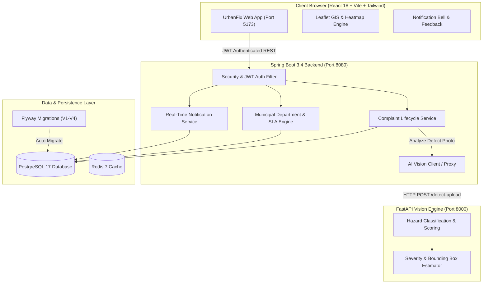

# 🏙️ UrbanFix AI — Smart Civic Issue Reporting, AI Computer Vision & Resolution System

[](https://spring.io/projects/spring-boot)
[](https://openjdk.org/)
[](https://react.dev/)
[](https://vitejs.dev/)
[](https://tailwindcss.com/)
[](https://fastapi.tiangolo.com/)
[](https://python.org/)
[](https://www.postgresql.org/)
[](https://redis.io/)
[](LICENSE)

**UrbanFix AI** is an enterprise-grade, full-stack civic engineering platform designed to modernize municipal public works management. Combining **AI computer vision defect detection**, **SLA-bound departmental dispatch**, **geospatial GIS mapping with hotspot heatmaps**, and a **closed-loop citizen feedback engine**, UrbanFix AI bridges the gap between citizens, field repair crews, and municipal administrators.

---

## 📑 Table of Contents
- [Key Features](#-key-features)
- [Architecture & Tech Stack](#-architecture--tech-stack)
- [System Architecture Diagram](#-system-architecture-diagram)
- [Project Directory Structure](#-project-directory-structure)
- [Demo Credentials & Role-Based Access Control](#-demo-credentials--role-based-access-control)
- [Quickstart Guide](#-quickstart-guide)
  - [Prerequisites](#prerequisites)
  - [1. Infrastructure (PostgreSQL & Redis)](#1-infrastructure-postgresql--redis)
  - [2. Spring Boot Backend](#2-spring-boot-backend)
  - [3. FastAPI AI Vision Microservice](#3-fastapi-ai-vision-microservice)
  - [4. React Vite Frontend](#4-react-vite-frontend)
- [Core Functional Workflows](#-core-functional-workflows)
  - [1. AI Vision Hazard Detection](#1-ai-vision-hazard-detection)
  - [2. Municipal Routing & SLA Engine](#2-municipal-routing--sla-engine)
  - [3. Geospatial GIS & Density Heatmaps](#3-geospatial-gis--density-heatmaps)
  - [4. Citizen Feedback & Dispute Resolution](#4-citizen-feedback--dispute-resolution)
- [REST API Reference](#-rest-api-reference)
- [Running Automated Tests](#-running-automated-tests)
- [Contributing & License](#-contributing--license)

---

## 🌟 Key Features

### 1. 🤖 AI-Powered Computer Vision Defect Detection
- Instant neural analysis of uploaded road, sanitation, and electrical hazard photos.
- Categorization across **Potholes, Open Garbage Dumps, Streetlight Outages, Water Pipe Leaks, and Fallen Trees**.
- Automatic hazard severity calculation (**LOW, MEDIUM, HIGH, CRITICAL**) with confidence scoring (0–100%) and bounding box annotations.
- 1-click **"Apply AI Recommendation"** in the issue submission form for instantaneous categorization and priority autofill.

### 2. 🔐 JWT Authentication & Granular RBAC
- Stateless JWT authentication with secure password hashing (`BCrypt`).
- 3 distinct user personas with dedicated dashboard views:
  - **Citizen (`ROLE_CITIZEN`)**: Issue reporting, live tracking, resolution ratings, reopen disputes, and alert subscriptions.
  - **Field Officer (`ROLE_OFFICER`)**: Department-filtered ticket queue, GPS turn-by-turn navigation, resolution evidence upload, status transitions.
  - **Municipal Administrator (`ROLE_ADMIN`)**: City-wide operational map, manual officer assignment, SLA breach tracking, citizen satisfaction scorecards.
- Interactive **1-Click Demo Persona Switcher** for frictionless testing.

### 3. ⏱️ Municipal Department Routing & Dynamic SLA Engine
- 5 municipal departments with pre-configured baseline resolution SLAs:
  - **Roads & Infrastructure** (24h baseline)
  - **Sanitation & Waste Management** (12h baseline)
  - **Electricity & Lighting** (24h baseline)
  - **Water Supply & Sewerage** (18h baseline)
  - **Parks & Public Amenities** (48h baseline)
- **Severity-adjusted SLA timers**:
  - `CRITICAL` issues receive a **50% expedited deadline** (e.g., 6 hours for sanitation).
  - `HIGH` receives **75%**, `MEDIUM` **100%**, and `LOW` **125%**.
- Real-time SLA breach countdown timers and administrative escalation alerts.

### 4. 🗺️ Interactive GIS Mapping & Hotspot Heatmaps
- OpenStreetMap & Leaflet-powered geospatial map interface with custom colored pins:
  - 🟡 `SUBMITTED` | 🔵 `ASSIGNED` | 🟠 `IN_PROGRESS` | 🟢 `RESOLVED` | ⚪ `CLOSED`
- **Dynamic Heatmap Toggle (`🔥 Heatmap`)**:
  - Computes geospatial density clusters and renders pulsing, severity-weighted heat rings around civic trouble spots.
  - Quick-filters by Department (`All`, `Roads`, `Sanitation`, `Electricity`, `Water`, `Parks`) and Status.

### 5. 📢 Real-Time Notification Bell & Citizen Feedback Loop
- **In-App Notification Bell** with live polling and unread badge counters.
- Automated instant alerts for complaint creation, officer assignment, repairs completed, and feedback received.
- **5-Star Citizen Rating Engine**: Citizens score repair quality with optional feedback upon completion.
- **Dispute / Reopen Workflow**: Citizens can challenge unsatisfactory resolutions with reason audits, re-routing tickets back to active repair.

### 6. ⚡ Real-Time WebSockets & STOMP Live Synchronization
- **Spring WebSocket & STOMP Broker**: Dual endpoints at `/ws` (SockJS fallback) and `/ws-raw` (Standard STOMP).
- **Instant Map & Feed Synchronization**: Broadcasts over `/topic/complaints` push new incident pins and status changes to all connected citizen, officer, and admin dashboards in real time.
- **User Notification Stream**: Dedicated pushes to `/topic/notifications/{userId}` deliver instant alert toasts and badge increments.
- **Client-Side Live Status Indicator**: Real-time `⚡ Socket: Live` status monitoring in the navigation bar.

---

## 🛠️ Architecture & Tech Stack

| Layer | Technologies | Description |
| :--- | :--- | :--- |
| **Frontend** | React 18, Vite 6, Tailwind CSS, Lucide Icons, Leaflet, React Leaflet, Axios | Modern reactive SPA with responsive desktop/mobile layouts, live map views, and modal dialogs. |
| **Backend** | Java 21 LTS, Spring Boot 3.4.x, Spring Data JPA, Spring Security 6, Flyway | Clean Modular Monolith providing REST APIs, JWT authentication, SLA computation, and persistence. |
| **AI Microservice** | Python 3.12, FastAPI, Uvicorn, Pydantic, Pillow | High-throughput asynchronous computer vision inference engine for hazard classification. |
| **Databases & Cache** | PostgreSQL 17, Redis 7 Alpine, Flyway Migrations | Relational persistence with version-controlled schema migrations (`V1` through `V4`) and fast caching. |
| **DevOps & CI/CD** | Docker Compose, Maven, GitHub Actions | Multi-container local orchestration, continuous integration, and automated test runners. |

---

## 📐 System Architecture Diagram



---

## 📂 Project Directory Structure

```text
urbanFix/
├── .github/
│   └── workflows/
│       └── ci.yml                          # GitHub Actions CI pipeline
├── ai-service/                             # Python 3.12 FastAPI microservice
│   ├── app/
│   │   ├── __init__.py
│   │   ├── main.py                         # FastAPI routes (/detect, /detect-upload, /health)
│   │   ├── schemas.py                      # Pydantic request/response models
│   │   └── inference.py                    # Computer vision heuristic & neural inference
│   ├── tests/
│   │   └── test_health.py                  # AI microservice unit test suite
│   ├── Dockerfile
│   └── requirements.txt
├── backend/                                # Java 21 Spring Boot modular monolith
│   ├── src/
│   │   ├── main/
│   │   │   ├── java/com/urbanfix/backend/
│   │   │   │   ├── ai/                     # AI vision proxy, DTOs & endpoints
│   │   │   │   ├── analytics/              # SLA compliance & satisfaction summary
│   │   │   │   ├── auth/                   # JWT filters, tokens & authentication controller
│   │   │   │   ├── common/                 # Global exception handlers & DataInitializer
│   │   │   │   ├── complaint/              # Issue lifecycle, ratings & dispute services
│   │   │   │   ├── department/             # Municipal departments & SLA configuration
│   │   │   │   ├── notification/           # Notification models, repo & controller
│   │   │   │   ├── upload/                 # Multipart file upload storage service
│   │   │   │   ├── user/                   # User entities, roles & repositories
│   │   │   │   └── BackendApplication.java
│   │   │   └── resources/
│   │   │       ├── db/migration/           # Flyway SQL migrations (V1, V2, V3, V4)
│   │   │       ├── application.yml         # Production PostgreSQL profile
│   │   │       └── application-dev.yml     # Local rapid-dev profile
│   │   └── test/                           # JUnit 5 & MockMvc unit & integration tests
│   └── pom.xml
├── frontend/                               # React 18 + Vite + Tailwind CSS
│   ├── src/
│   │   ├── components/
│   │   │   ├── AuthModal.jsx               # Login modal with 1-click role switcher
│   │   │   ├── DepartmentsSection.jsx      # Live SLA & department metrics cards
│   │   │   ├── MapView.jsx                 # Leaflet map with Hotspot Heatmap toggle
│   │   │   ├── Navbar.jsx                  # Header with Notification Bell & auth controls
│   │   │   ├── NotificationBell.jsx        # Notification dropdown & live unread counter
│   │   │   ├── ReportIssueModal.jsx        # Issue reporting with AI vision analysis
│   │   │   ├── RoleDashboard.jsx           # Tailored Citizen, Officer & Admin views
│   │   │   └── TrackIssueModal.jsx         # Lifecycle tracker, 5-star rating & dispute modal
│   │   ├── context/
│   │   │   └── AuthContext.jsx             # React Auth context & token management
│   │   ├── services/
│   │   │   └── api.js                      # Axios instance with JWT interceptors
│   │   ├── App.jsx
│   │   └── main.jsx
│   ├── package.json
│   └── vite.config.js
├── infrastructure/
│   ├── docker-compose.yml                  # PostgreSQL 17 & Redis 7 container orchestration
│   ├── .env                                # Local environment secrets (Git-ignored)
│   └── .env.example                        # Template credentials
├── docs/                                   # Architecture, API & setup docs
└── README.md
```

---

## 👥 Demo Credentials & Role-Based Access Control

The system comes pre-seeded with three demo accounts so you can test all workflows immediately:

| Role | Email | Password | Permissions |
| :--- | :--- | :--- | :--- |
| **Citizen** | `citizen@urbanfix.com` | `Citizen@123` | Report issues with AI scan, view personal reports, receive status alerts, rate resolutions (1–5★), reopen disputes. |
| **Field Officer** | `officer@urbanfix.com` | `Officer@123` | View assigned department work queue, inspect SLA countdowns, update statuses (`IN_PROGRESS`, `RESOLVED`), upload resolution photos. |
| **Municipal Admin** | `admin@urbanfix.com` | `Admin@123` | City-wide dashboard, manual officer dispatch, departmental SLA compliance monitoring, citizen satisfaction analytics. |

> 💡 *Tip: In the login modal, use the **1-Click Demo Fill** buttons (`Citizen`, `Officer`, `Admin`) to instantly populate credentials.*

---

## 🚀 Quickstart Guide

You can run UrbanFix AI using either the **single-command Docker deployment** (recommended for production/demos) or the **local developer setup** (for active coding).

---

### Option A: 🐳 Single-Command Docker Deployment (Recommended)

Run the entire platform (PostgreSQL 17, Redis 7, FastAPI Vision Engine, Spring Boot 3.4 Backend, and Nginx React Frontend) in one command:

```powershell
# 1. Clone the repository
git clone https://github.com/saksham9541/urbanFix.git
cd urbanFix

# 2. Launch the complete containerized stack
docker compose up --build -d
```

Once running:
- **Web Application**: [http://localhost](http://localhost) (or [http://localhost:5173](http://localhost:5173))
- **Spring Boot API**: [http://localhost:8080/api/health](http://localhost:8080/api/health)
- **FastAPI AI Vision Docs**: [http://localhost:8000/docs](http://localhost:8000/docs)

To view live container logs:
```powershell
docker compose logs -f
```

---

### Option B: 💻 Local Developer Setup

#### Prerequisites
- **Git**
- **Java 21 LTS**
- **Node.js 18+ & npm**
- **Python 3.12+**
- **Docker Desktop** (for PostgreSQL & Redis)

#### 1. Infrastructure (PostgreSQL & Redis)
Start the PostgreSQL 17 and Redis 7 containers:
```powershell
cd infrastructure
docker compose up -d
```
Verify container health:
```powershell
docker exec urbanfix-postgres pg_isready -U urbanfix -d urbanfix
docker exec urbanfix-redis redis-cli ping
```

---

### 2. Spring Boot Backend
Open a terminal in `backend`:
```powershell
cd backend
# Build and run the Spring Boot application (using Maven wrapper)
.\mvnw.cmd spring-boot:run
```
*The backend starts at `http://localhost:8080`. Flyway will automatically apply database migrations `V1` through `V4` and seed demo users, departments, and issues.*

Verify backend health:
```powershell
curl http://localhost:8080/api/health
```

---

### 3. FastAPI AI Vision Microservice
Open a second terminal in `ai-service`:
```powershell
cd ai-service
# Install Python dependencies
pip install -r requirements.txt

# Start FastAPI inference server
python -m uvicorn app.main:app --host 0.0.0.0 --port 8000 --reload
```
*The AI service starts at `http://localhost:8000`. Interactive Swagger UI is available at `http://localhost:8000/docs`.*

Verify AI service health:
```powershell
curl http://localhost:8000/health
```

---

### 4. React Vite Frontend
Open a third terminal in `frontend`:
```powershell
cd frontend
# Install Node dependencies
npm install

# Start Vite dev server
npm run dev
```
Open **`http://localhost:5173`** in your browser. The navbar indicator will show `Backend: Online` and `AI Vision: Online`.

---

## 🔄 Core Functional Workflows

### 1. AI Vision Hazard Detection
1. Click **"Report Issue"** in the top navigation bar.
2. Upload a photo of a road, trash, or electrical defect (or click one of the pre-loaded sample hazard images).
3. The AI engine instantly inspects the image via `POST /api/ai/analyze`, identifying:
   - Defect type (e.g. `POTHOLE`, `GARBAGE`, `STREETLIGHT`)
   - Severity level (`LOW`, `MEDIUM`, `HIGH`, `CRITICAL`)
   - Model confidence score (e.g. `94%`)
   - Suggested municipal department (e.g. `ROADS`)
4. Click **"Apply AI Recommendation"** to autofill the form in one click.
5. Click **"Detect My Location"** for GPS coordinates, and submit the ticket. The system assigns a unique tracking number (e.g. `UF-2026-10005`).

### 2. Municipal Routing & SLA Engine
- When an issue is logged, the backend computes an SLA deadline based on the assigned department's baseline and the severity:
  $$\text{Target SLA} = \text{Baseline Hours} \times \text{Severity Multiplier}$$
  *(e.g., Sanitation baseline 12h $\times$ Critical 0.5 = **6 hours**)*.
- The Admin dashboard displays SLA performance metrics, breach warnings, and an officer assignment modal.
- Assigned field officers see tickets appear directly in their personal queue.

### 3. Geospatial GIS & Density Heatmaps
- The Leaflet map displays color-coded markers for each civic incident.
- Click **"🔥 Heatmap On"** in the map toolbar:
  - The map computes spatial density clusters.
  - Concentric, pulsating heat rings render over high-incident neighborhoods.
  - Ring radii and colors adjust dynamically according to incident severity and concentration.

### 4. Citizen Feedback & Dispute Resolution
- When an officer marks a ticket as `RESOLVED`, an automated notification appears in the Citizen's notification bell.
- The citizen opens the ticket:
  - **Option A (Satisfaction)**: Select 1 to 5 stars, leave a feedback comment, and click **"Submit Rating"**. The ticket transitions to `CLOSED`.
  - **Option B (Dispute)**: If the repair is inadequate, click **"Dispute / Reopen Issue"**, supply the reason, and the ticket immediately reverts to `IN_PROGRESS` with an escalation audit entry.

---

## 📡 REST API Reference

### Authentication (`/api/auth`)
| Method | Endpoint | Access | Description |
| :--- | :--- | :--- | :--- |
| `POST` | `/api/auth/register` | Public | Register new citizen account |
| `POST` | `/api/auth/login` | Public | Authenticate user & receive JWT token |
| `GET` | `/api/auth/me` | Authenticated | Retrieve current authenticated user profile |

### Civic Complaints (`/api/complaints`)
| Method | Endpoint | Access | Description |
| :--- | :--- | :--- | :--- |
| `GET` | `/api/complaints` | Public | List complaints with category & status filters |
| `POST` | `/api/complaints` | Citizen | Submit a new complaint with GPS & photo |
| `GET` | `/api/complaints/{id}` | Public | Retrieve complaint details by ID |
| `GET` | `/api/complaints/track/{trackingNumber}` | Public | Lookup ticket by `UF-YYYY-XXXXX` identifier |
| `PATCH` | `/api/complaints/{id}/status` | Officer / Admin | Transition lifecycle status (`IN_PROGRESS`, `RESOLVED`, etc.) |
| `POST` | `/api/complaints/{id}/assign` | Admin | Dispatch ticket to a specific field officer |
| `GET` | `/api/complaints/officer/tickets` | Officer | Retrieve officer's assigned work queue |
| `POST` | `/api/complaints/{id}/rate` | Citizen | Submit 1–5 star rating and feedback comment |
| `POST` | `/api/complaints/{id}/reopen` | Citizen | Reopen ticket with dispute rationale |

### AI Vision Service (`/api/ai` & FastAPI `:8000`)
| Method | Endpoint | Service | Description |
| :--- | :--- | :--- | :--- |
| `POST` | `/api/ai/analyze` | Spring Boot Proxy | Proxies photo to AI vision engine with fallback |
| `GET` | `/api/ai/health` | Spring Boot Proxy | Checks backend-to-AI microservice connectivity |
| `POST` | `/detect` | FastAPI | Inference from raw JSON image URL/Base64 |
| `POST` | `/detect-upload` | FastAPI | Direct multipart form-data image inference |
| `GET` | `/health` | FastAPI | Direct AI microservice health check |

### Notifications & Analytics
| Method | Endpoint | Access | Description |
| :--- | :--- | :--- | :--- |
| `GET` | `/api/notifications` | Authenticated | Fetch user's notification list |
| `GET` | `/api/notifications/unread-count` | Authenticated | Get count of unread notifications |
| `PATCH` | `/api/notifications/{id}/read` | Authenticated | Mark a single notification as read |
| `PATCH` | `/api/notifications/read-all` | Authenticated | Mark all notifications as read |
| `GET` | `/api/analytics/sla-summary` | Admin / Officer | Get city SLA compliance & satisfaction index |
| `GET` | `/api/departments` | Public | List municipal departments & baseline SLAs |

---

## 🧪 Running Automated Tests

### 1. Spring Boot Backend Tests (JUnit 5 + MockMvc)
```powershell
cd backend
.\mvnw.cmd test
```
*Verifies JWT security filtering, complaint state machine, SLA calculation, and notification dispatching.*

### 2. FastAPI AI Service Unit Tests
```powershell
cd ai-service
python -m unittest discover tests
```
*Runs automated checks for inference output schema validation, bounding box generators, and health endpoints.*

### 3. Frontend Production Build Check
```powershell
cd frontend
npm run build
```
*Validates React JSX compilation, Tailwind utility purges, and bundle asset generation.*

---

## 👥 Contributors & Academic Context

- **Author**: Saksham ([@saksham9541](https://github.com/saksham9541))
- **Project**: UrbanFix AI — Capstone Engineering Project
- **Repository**: [https://github.com/saksham9541/urbanFix](https://github.com/saksham9541/urbanFix)

---

## 📄 License
This project is licensed under the [MIT License](LICENSE).
